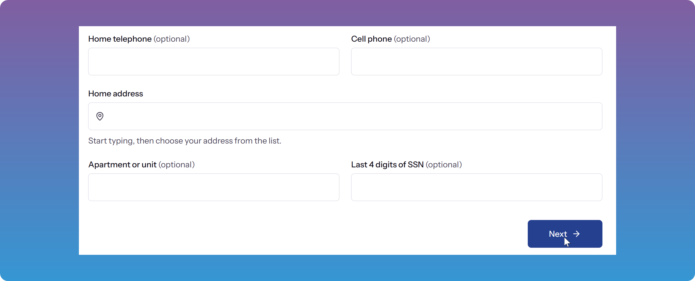
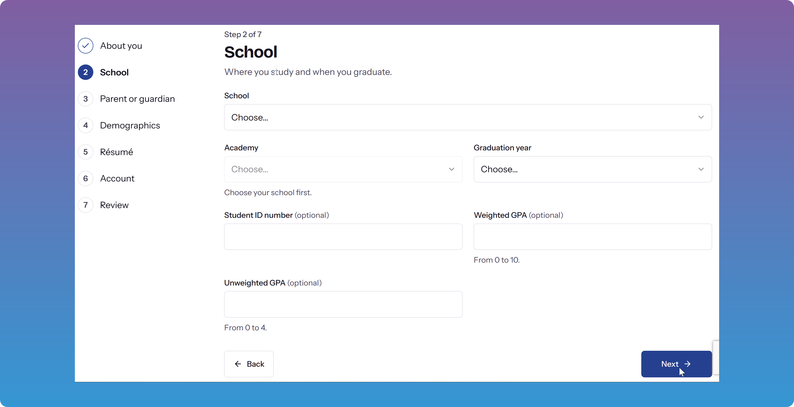
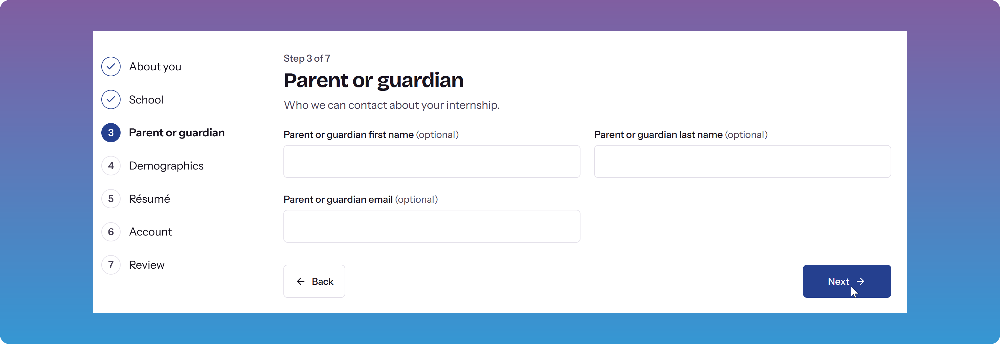
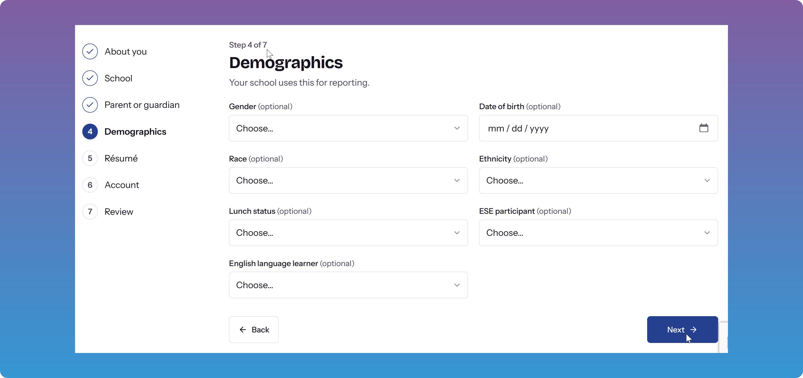
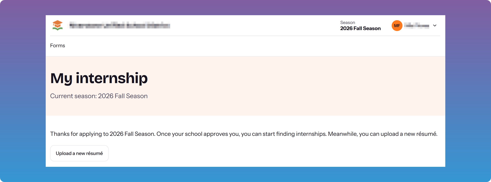
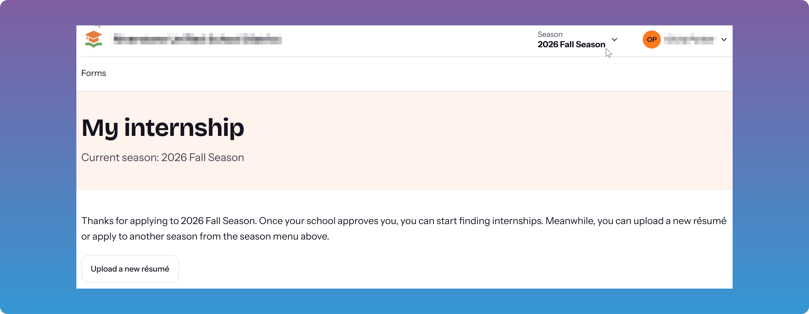

# Getting Started

## Registering as a Student

Welcome to GetMyInterns! This guide will help you take your first steps.

Click on **_Register_** under `Students` to create your account. Fill in the required data as shown on the pictures below.

:::info

Your `school/district` might have different requirements in the information they require so you might see different fields from the pictures above.

:::

:::info

The **Academy** is an `Area of Study`, a category or field in which you focus your academic and internship pursuits. Since different schools/districts have different names for it, you may find a different name for the **Academy** field in the picture above. Some schools/districts call them `Academies`, `Pathways`, `Tracks`, `Concentrations`, etc.

:::

## Seasons

If there is only one active `Season`, you will see it in the screen after registering, already applied to. 

If there are two or more active seasons, you need to apply to one.

You can click on the `Season` at the top of the screen to apply to another active `Season`.

## Forms

If there are any `Forms` that you are required to fill in, you can download them by clicking at **_Forms_** at the top menu (even if you are still pending approval).

