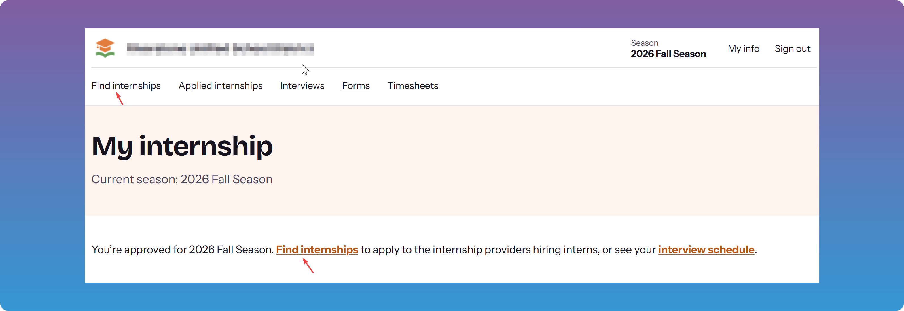
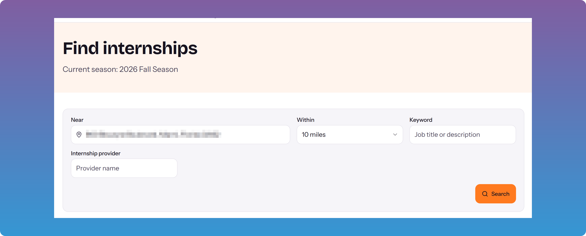
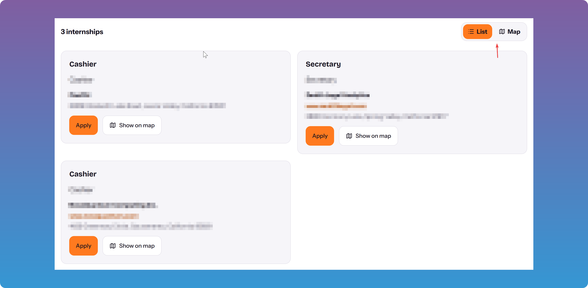
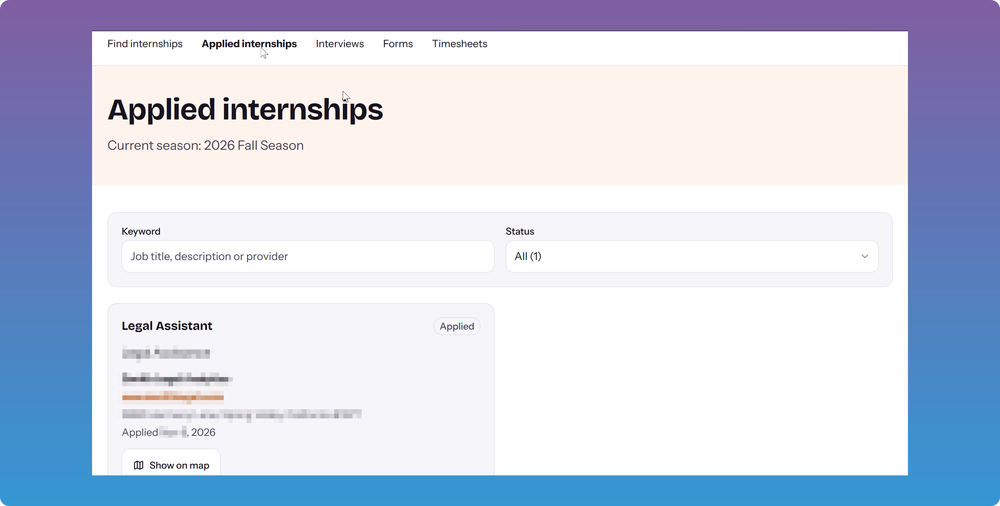
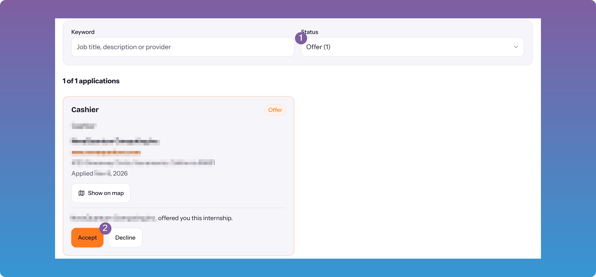
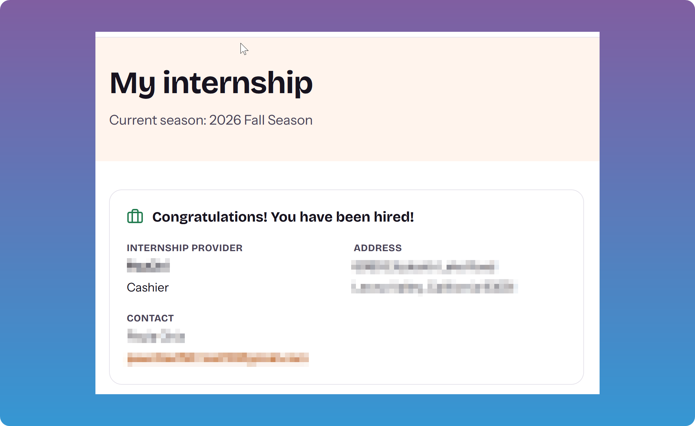

# Finding and Managing Internships

In order to apply for internships your `school/district` might need to approve you first after [registering](/students/getting-started#registering-as-a-student).

## How to Search and Apply for Internships

You can search for internships of your interest by clicking on **_Find Internships_** on `My Internship` screen, or clicking on **_Internships - Find Internships_** within the menu.

You can fill in your location and the radius within which to search, the `Industry` you are interested in and you can even use a keyword to search. You can also search for a specific `Internship Provider` if you already know which one you are interested in.

You will see a list of `Job` offers. You can toggle between the **_Map_** view and **_List_** view from the buttons on the right. The **_Map_** view will pinpoint the `Job` offers locations.

Simply click on **_Apply_** at the bottom of the offer you are interested in. The `Internship Provider` will receive your application.

## Tracking Your Internship Applications and Status

Click on **_Internships - Applied Internships_** to get a list of `Internships` you have already applied to, and their status. You can search by keyword or status.

## How to Accept or Decline Internship Offers

Click on **_Internships - Applied Internships_** and search by status "Offer" to see a list of `Job` offers made by `Internship Providers` to you.

Just click on the respective button to **_Accept_** or **_Decline_** the offer.

:::info

If the **_Accept_** and **_Decline_** buttons are not clickable, please contact your internship coordinator to let them know you are interested in that specific offer. If this is the case, you will receive an email when the offer has been approved or declined.

:::

If the offer is approved, you will see this screen when signing in to your account.

When you accept an offer you will receive an email letting you know all pending `Interviews` have been cancelled, and the corresponding `Internship Providers` will also be notified as well as when you decline an offer.
