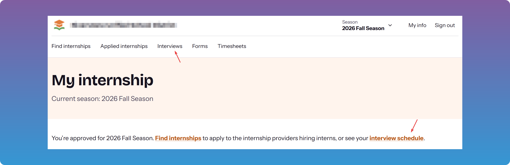
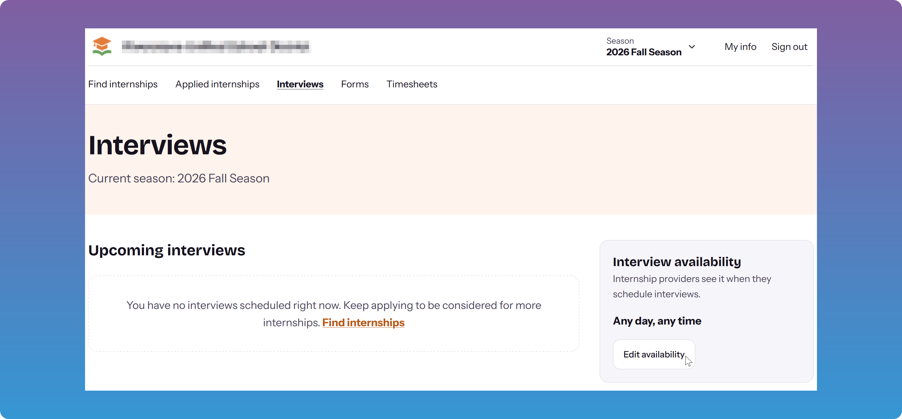
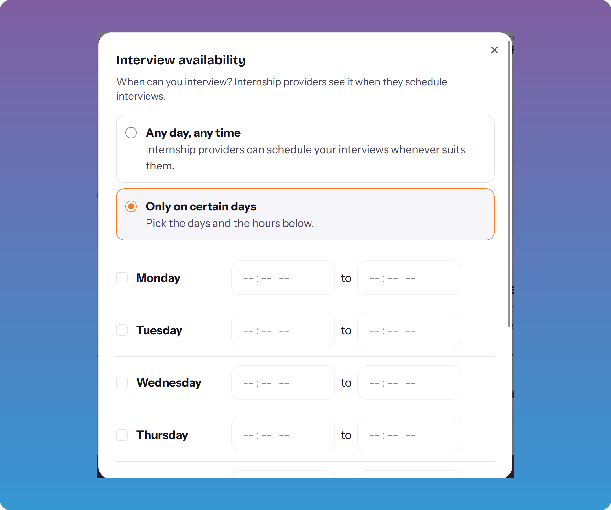
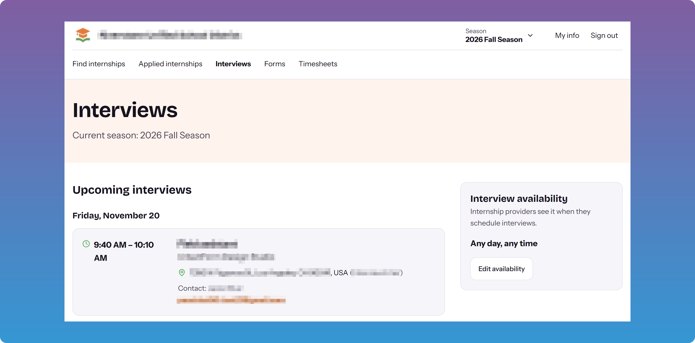

# Interviews

## Setting Up Your Interview Availability

Click on **_Interviews_**, or on **_interview schedule_** on the  text, and configure your availability for interviews. `Internship Providers` and `School Administrators` will have access to this availability to schedule interviews with you.

## Managing Your Upcoming Interviews

You will receive an email when an `Internship Provider` schedules an `Interview`.

On the platform, click on **_Interviews_** to see a list of them, with date, name of the `Internship Provider`, job, time, address and contact info.

